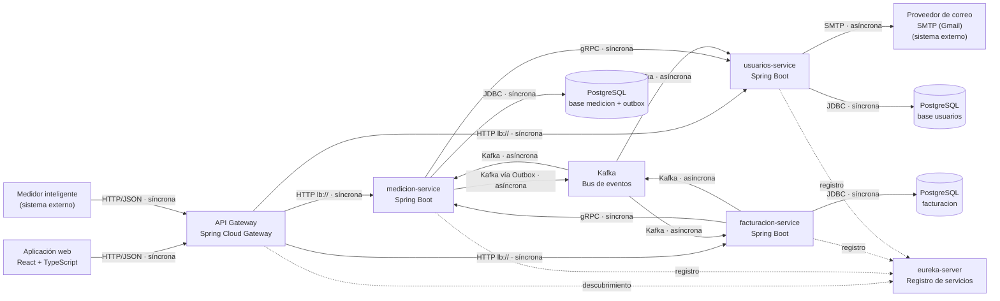

# Arquitectura de Smart Grid (Grupo 9)

## 1. Contexto y motivadores

Smart Grid monitorea el consumo eléctrico de medidores inteligentes, detecta anomalías de consumo, avisa por correo al usuario y produce la facturación periódica. Lo usan el usuario/hogar (consulta su consumo y sus facturas y recibe las alertas) y el operador de red (registra medidores, resuelve anomalías, factura y ve el consumo por zona). El alcance está definido por el documento Requisitos_G9 (HU-01 a HU-09, R1 a R4, RNF1 a RNF3).

**Atributos de calidad prioritarios (ordenados).** El orden sale de los requisitos no funcionales del documento Requisitos_G9.

1. **Confiabilidad de la facturación** (RNF2, R2). *Escenario:* si entre las lecturas de un período hay un hueco mayor a la separación máxima configurada, `periodoCompleto` devuelve `false` y la factura no se genera (`PeriodoNoCerradoException`). Se verifica con un test unitario.
2. **Oportunidad de las alertas** (RNF3, HU-04, HU-05). *Escenario:* una lectura que supera el umbral relativo al histórico del medidor guarda la anomalía y escribe el evento `anomalias.detectadas` en el outbox dentro de la misma transacción del `POST` de la lectura, no al facturar; el sondeo del outbox lo publica en Kafka en un máximo de 2 s y usuarios-service envía el correo al consumirlo.
3. **Rendimiento sostenido de lecturas** (RNF1). *Escenario:* un `POST` de lectura no carga el historial completo del medidor, de modo que el número de consultas por `POST` no crece con el tamaño del historial. Verificado por inspección del código el 2026-11-17 (tres operaciones de lectura en la base, sin cargar la lista de lecturas); no se midió bajo carga.
4. **Seguridad (control de acceso).** *Escenario:* `DELETE /api/medidores/{medidorId}` solo lo acepta quien tiene rol OPERADOR; una factura solo la consulta un OPERADOR o el propietario del medidor.
5. **Testabilidad.** *Escenario:* las reglas de dominio se prueban sin base de datos ni red; cada servicio tiene su propia suite (conteo estático de clases de test: eureka-server 1, gateway 1, medicion 8, facturacion 8, usuarios 5). Los `contextLoads` de facturacion y usuarios exigen Docker activo.

**Restricciones reales.**
- Equipo de backend de dos personas: Dev 1 (medicion y las notificaciones de HU-05 en usuarios-service) y Liceth (facturacion y usuarios).
- Pila definida: Java 25, Spring Boot 4.1.2, Spring Data JPA, PostgreSQL 16 en Docker Compose, Windows.
- El proyecto llega solo hasta la comunicación entre microservicios (decisión del 2026-11-10): no se construyen más arquitecturas.
- Las notificaciones de HU-05 se entregan desde usuarios-service mediante consumidores Kafka y SMTP.

## 2. Estilos y patrones por componente

| Componente | Estilo / patrón | Almacén de datos | Comunicación | Atributo que sirve |
|---|---|---|---|---|
| gateway | API Gateway; enruta por nombre de servicio (`lb://`) con descubrimiento de Eureka. Rutas: `/api/medidores/**` y `/api/anomalias/**` a medicion; `/api/facturas/**` y `/api/tarifas/**` a facturacion; `/api/auth/**` y `/api/usuarios/**` a usuarios | — | HTTP entrante; HTTP hacia los servicios | Seguridad (único punto de entrada) |
| usuarios-service | Microservicio + puertos y adaptadores; JWT HS256; consumidor Kafka de alertas y envío de correo por SMTP (`NotificacionAlertasService`, puerto `EnviadorCorreo`) | PostgreSQL, base `usuarios` | HTTP (sirve); gRPC `ExisteUsuarioActivo` en el puerto 9091 (sirve); eventos `anomalias.detectadas` y `sensores.defectuosos` (consume); SMTP (envía) | Seguridad; testabilidad; oportunidad de las alertas |
| medicion-service | Microservicio + puertos y adaptadores; detección de anomalías en el `POST` de la lectura | PostgreSQL, base `medicion` | HTTP (sirve); gRPC (sirve consumo y anomalías a facturacion; llama a usuarios con plazo de 5 s); eventos vía Outbox (publica); `facturas.marcadas-huerfanas` (consume) | Oportunidad de las alertas; rendimiento sostenido de lecturas |
| facturacion-service | Microservicio + puertos y adaptadores; facturación mensual programada | PostgreSQL, base `facturacion` (facturas, tarifas y copia local de medidores) | HTTP (sirve); gRPC (llama a medicion con Circuit Breaker); consume eventos de medidores y publica `facturas.marcadas-huerfanas` | Confiabilidad de la facturación; testabilidad |
| Outbox + Kafka | Transactional Outbox con sondeo (lotes de hasta 50, cada 2 s) y publicación en Kafka | Tabla outbox en la base de medicion | Publicar / suscribir | Oportunidad de las alertas; confiabilidad de la facturación |
| Eliminación de medidor | Flujo asíncrono por eventos: `DELETE` responde 202; facturacion marca las facturas huérfanas y lo confirma; medicion elimina el medidor al recibir la confirmación (no se presenta como saga completa) | — | Eventos | Seguridad (solo un OPERADOR la inicia) |

eureka-server no tiene fila propia porque no sirve por sí mismo a ninguno de los cinco atributos: es soporte del gateway. El problema que resuelve es que el gateway enruta por nombre de servicio en lugar de por dirección y puerto fijos.

**Prueba de necesidad.**
- Gateway: un solo punto de entrada para la aplicación web y el medidor.
- Outbox: evita guardar en la base y publicar en Kafka por separado (escritura dual).
- gRPC: consultas síncronas donde quien llama necesita la respuesta ya (¿el usuario existe y está activo?, ¿cuánto consumió el medidor en el período?).
- Consumidor Kafka en usuarios-service: la alerta llega al usuario sin que medicion conozca los correos ni espere el envío.
- Puertos y adaptadores: probar el dominio sin infraestructura (fitness function 1).

**Antipatrones revisados.**
- Monolito distribuido por cadenas síncronas: no se observan cadenas de más de dos saltos entre servicios (facturacion→medicion; medicion→usuarios al registrar un medidor).
- Base de datos compartida: no; cada servicio apunta a su propia base (ADR-003, fitness function 2).
- Estilos sin problema concreto: CQRS y la saga no se construyeron y no figuran como implementados.

## 3. Diagrama de contenedores (C4)

Cada servicio se conecta a su propia base: medicion a `medicion` (puerto 5432), facturacion a `facturacion` (5433) y usuarios a `usuarios` (5435), según el `application.yaml` y el `docker-compose.yaml` de cada servicio. Kafka se declara en `infra/docker-compose.yaml`. El envío de correo sale de usuarios-service hacia el servidor SMTP configurado en su `application.yaml` (`smtp.gmail.com:587`).

**Conexiones.** Consultar es síncrono (gRPC o HTTP); propagar un hecho es asíncrono (evento por outbox y Kafka).

**Eventos.**

| Evento (tema) | Productor | Consumidor | Datos |
|---|---|---|---|
| `anomalias.detectadas` | medicion (outbox) | usuarios-service (`AlertasConsumoListener`) | Identificador del medidor, usuario destinatario (cuando existe), valor, instante, razón, identificador de la anomalía, estado de resolución y marca de sensor defectuoso |
| `sensores.defectuosos` | medicion (outbox) | usuarios-service (`AlertasConsumoListener`) | Identificador del medidor, usuario destinatario (cuando existe), valor recibido (el valor negativo), instante y razón |
| `medidores.registrados` | medicion | facturacion (`MedidorRegistradoListener`) | Lo que facturacion necesita para mantener su copia local del medidor (`MedidorLocal`) |
| `medidores.en-eliminacion` | medicion | facturacion (`MedidorEnEliminacionListener`) | Lo que facturacion necesita para reaccionar sobre su copia local del medidor |
| `facturas.marcadas-huerfanas` | facturacion | medicion (`FacturasMarcadasListener`) | Identificador del medidor y la cantidad de facturas marcadas; confirma que se puede eliminar el medidor |

**Capa anticorrupción.** El único sistema externo que entra al sistema es el medidor inteligente. Su lectura entra por `MedicionController.registrarLectura`, que descarta valores negativos (R1) y emite `sensores.defectuosos`. No se construyó una capa anticorrupción separada. El proveedor de correo es un sistema externo de salida, aislado detrás del puerto `EnviadorCorreo`.

## 4. Decisiones (ADR)

- ADR-001: Descomponer el backend en tres microservicios (Aceptada)
- ADR-002: Comunicación: gRPC para consultas y Outbox con Kafka para hechos, detrás de un gateway (Aceptada)
- ADR-003: Una base de datos PostgreSQL por servicio (Aceptada)
- ADR-004: CQRS para las consultas de lectura (**Propuesta, no implementada**)
- ADR-005: Entrega de alertas por correo desde usuarios-service (**Aceptada**)

### ADR-001: Descomponer el backend en tres microservicios

- Estado: Aceptada
- Fecha: 2026-10-27

**Contexto.** El backend empezó como un solo proyecto Spring Boot dividido en subdominios (Medición y anomalías, Facturación) con ramas por desarrollador. Usuarios nació directamente como proyecto independiente. La etapa del curso era la comunicación entre microservicios (Lección 6), y el equipo es de dos personas con dueños distintos por dominio.

**Decisión.** El backend queda en tres microservicios, uno por contexto delimitado: medicion-service (Dev 1), facturacion-service y usuarios-service (Liceth; las notificaciones de HU-05 en usuarios-service las implementó Dev 1), con un gateway como entrada y un eureka-server. Cada servicio tiene su propia suite de tests.

**Consecuencias.**
- (+) Cada dominio se desarrolla, prueba y ejecuta por separado; las reglas de facturación no dependen del código de medición.
- (+) Cada servicio tiene su propio contrato (gRPC o HTTP) y su propio control de acceso.
- (−) Más piezas que operar: tres servicios, gateway, eureka-server, Kafka, las bases de datos (cada una con puerto propio) y un proveedor de correo externo.
- (−) Lo que antes era una llamada en proceso ahora es una llamada de red: si medicion-service no responde, no se puede generar una factura; si usuarios-service no responde, medicion responde 503.
- (−) Datos duplicados (copia local de medidores en facturacion) y consistencia eventual entre servicios.
- (−) Los `contextLoads` de facturacion y usuarios fallan sin Docker activo.
- (−) No se midió una ganancia de escalabilidad por servicio; la decisión se tomó por separación de dominios y por el objetivo del curso.

**Alternativa descartada.** Monolito modular (el estado inicial): se descartó porque el objetivo de esta etapa era practicar la comunicación entre servicios. Su ventaja, evitar fallas de red y duplicación de datos, se pierde.

### ADR-002: Comunicación: gRPC para consultas y Outbox con Kafka para hechos, detrás de un gateway

- Estado: Aceptada
- Fecha: 2026-10-27

**Contexto.** medicion necesita saber si un usuario existe y está activo al registrar un medidor. facturacion necesita el consumo y las anomalías no resueltas del período para facturar, y necesita conocer los medidores activos para la facturación mensual sin consultar a medicion cada vez. Una lectura negativa y una anomalía deben emitir un evento sin perderlo, y usuarios-service necesita recibirlos para avisar al usuario.

**Decisión.**
- Consultas síncronas por gRPC: `ExisteUsuarioActivo` (usuarios, puerto 9091) con plazo de 5 s, y la obtención de consumo y anomalías de medicion para facturacion.
- Hechos asíncronos con Transactional Outbox: el evento se guarda en la misma transacción que el cambio de negocio y un sondeo (lotes de hasta 50, cada 2 s) lo publica en Kafka. facturacion consume los eventos de medidores y publica la confirmación `facturas.marcadas-huerfanas`, que medicion consume; usuarios consume los de anomalías y sensores defectuosos (ADR-005).
- Entrada única por el gateway, que enruta por nombre de servicio (`lb://`) con Eureka.
- JWT validado en cada servicio con el secreto compartido emitido por usuarios.

**Consecuencias.**
- (+) No se pierden eventos aunque Kafka esté caído, porque el evento queda en la base junto con el cambio.
- (+) facturacion conoce los medidores por eventos y no depende de medicion para esa lista.
- (+) Si usuarios no responde dentro de 5 s, medicion captura el error y responde 503, sin colgarse.
- (+) facturacion aplica un Circuit Breaker programático en sus dos clientes gRPC hacia medicion.
- (−) Los consumidores pueden recibir duplicados; la tolerancia es parcial (ver sección 7).
- (−) El sondeo añade una espera de hasta el intervalo de 2 s antes de publicar y un proceso más que operar.
- (−) Las llamadas gRPC entre servicios se permiten sin autenticación (`GrpcSecurityConfig`), y el secreto JWT es compartido entre servicios.
- (−) medicion-service, que llama a usuarios, no aplica Circuit Breaker: solo usa el plazo de 5 s y la respuesta 503.
- (−) usuarios-service pasó a depender de Kafka para recibir las alertas (ADR-005): si el broker no está disponible, el servicio no recibe los eventos.

**Alternativas descartadas.**
- Guardar en la base y publicar en Kafka por separado (escritura dual): puede dejar el sistema inconsistente si el proceso cae entre ambas.
- Que facturacion consulte por gRPC la lista de medidores en cada corrida mensual: la haría depender de la disponibilidad de medicion para algo que puede propagarse después.

### ADR-003: Una base de datos PostgreSQL por servicio

- Estado: Aceptada
- Fecha: 2026-10-27

**Contexto.** El diagrama C4 inicial tenía una sola base de datos PostgreSQL para el backend. Con tres servicios, cada uno con su dueño, compartir esquema ata los cambios de un servicio a los de otro.

**Decisión.** Cada servicio es dueño de sus tablas y ningún servicio lee la base de otro; los datos ajenos llegan por gRPC o por eventos. medicion guarda medidores, lecturas, anomalías y el outbox; facturacion guarda facturas, tarifas (entidad propia, con vigencias sin superposición) y la copia local de medidores; usuarios guarda las cuentas.

**Consecuencias.**
- (+) Cada servicio puede cambiar su esquema sin coordinarse con los demás.
- (+) Verificado el 2026-11-12 en los `application.yaml` y los `docker-compose.yaml`: medicion usa la base `medicion` (puerto 5432), facturacion la base `facturacion` (5433) y usuarios la base `usuarios` (5435), cada una en su propio servicio de Compose.
- (+) Cada base usa un volumen con nombre en su `docker-compose.yaml`, de modo que los datos sobreviven a recrear el contenedor.
- (−) Datos duplicados (copia local de medidores) que pueden quedar desfasados hasta que llegue el evento.
- (−) El consumo acumulado no se guarda: se calcula sumando lecturas cada vez que se pide (`GET /api/medidores/{medidorId}/consumo`) y no existe una entidad `ConsumoAcumulado`.
- (−) Sin transacción entre servicios, la consistencia depende de eventos e idempotencia.

**Alternativa descartada.** Una base compartida por los tres servicios: permitiría uniones y transacciones únicas, pero acopla los esquemas, que es lo que la descomposición (ADR-001) busca evitar.

### ADR-004: CQRS para las consultas de lectura

- Estado: **Propuesta. No implementada.**
- Fecha: 2026-11-12

**Contexto.** El historial de consumo (HU-07) y el consumo por zona (HU-09) se leen hoy del mismo modelo transaccional de medicion donde se escriben las lecturas. El volumen sostenido de lecturas (RNF1) compite con esas consultas.

**Decisión propuesta.** Mantener la escritura de lecturas en medicion y crear un modelo de lectura separado, alimentado por eventos, para el historial y el consumo por zona. Hoy no existe un evento de lectura registrada que lo alimente.

**Consecuencias esperadas.**
- (+) Las consultas no compiten con la escritura sostenida de lecturas.
- (−) Consistencia eventual: el historial puede ir un poco por detrás de la última lectura.
- (−) Un componente más, un evento nuevo y más almacenamiento por operar.

**Alternativa considerada.** Mantener un solo modelo y limitar el costo con consultas acotadas y paginación dentro de medicion. No requiere componentes nuevos.

### ADR-005: Entrega de alertas por correo desde usuarios-service

- Estado: **Aceptada**
- Fecha: 2026-11-02 (decisión del equipo), registrada el 2026-11-12
- Validación de extremo a extremo con Gmail: realizada el 2026-11-15 (lectura simulada, anomalía y sensor defectuoso, correos recibidos por el usuario)

**Contexto.** HU-05 pide que el usuario reciba una alerta cuando se detecta una anomalía en su consumo, y la regla R1 pide una alerta de sensor defectuoso ante una lectura negativa. medicion genera y emite `anomalias.detectadas` y `sensores.defectuosos`; usuarios-service es dueño de los correos de las cuentas, por lo que entrega las alertas por SMTP.

**Decisión.** usuarios-service consume `anomalias.detectadas` y `sensores.defectuosos` (grupo `usuarios-service`) y envía un correo por SMTP al usuario asociado al medidor. La lógica está en `NotificacionAlertasService`, detrás del puerto `EnviadorCorreo`; `EnviadorCorreoSmtp` y `AlertasConsumoListener` son los adaptadores. Las credenciales SMTP son las de una cuenta de Gmail desechable creada solo para el proyecto, definidas como valores por defecto en el `application.yaml`; se pueden sobrescribir con las variables de entorno `MAIL_USERNAME` y `MAIL_PASSWORD`. Esos valores por defecto son solo de desarrollo y no deben usarse en despliegues.

**Consecuencias.**
- (+) usuarios ya es dueño de los correos de las cuentas; medicion no necesita conocerlos ni esperar el envío.
- (+) Un fallo de SMTP o un evento inválido se registra en el log y no afecta a medicion ni a facturacion.
- (−) usuarios-service ahora depende de Kafka y de un proveedor de correo externo (SMTP de Gmail con contraseña de aplicación).
- (−) Sin reintentos ni deduplicación: el listener captura los errores y da el mensaje por procesado, así que un fallo de SMTP no se reintenta y un evento reentregado puede producir un correo duplicado. `auto-offset-reset: latest` solo aplica cuando el grupo no tiene un offset confirmado; el comportamiento ante un apagado de usuarios-service no se probó. La anomalía sigue consultable por API y visible en la pantalla Alertas.
- (−) La contraseña de aplicación de la cuenta desechable queda en el repositorio para que el proyecto funcione al clonarlo; cualquiera con acceso al repositorio puede enviar correos desde esa cuenta. Se acepta porque la cuenta es solo de desarrollo y se revoca al terminar la entrega.
- (−) El sensor defectuoso se notifica solo por correo; no se persiste.

**Alternativa considerada.** Que medicion envíe el correo directamente: mezclaría en medición una responsabilidad de comunicación con usuarios y necesitaría conocer sus correos.

## 5. Fitness functions

1. **El dominio no importa infraestructura.**
   - *Regla:* ninguna clase de un paquete `dominio` importa algo de `infraestructura`.
   - *Verificación:* desde la raíz del repositorio, en PowerShell:
     `Get-ChildItem -Recurse -Path "*\src\main\java" -Filter "*.java" | Where-Object { $_.FullName -match "\\dominio\\" } | Select-String -Pattern "import .*infraestructura"`
     No debe haber coincidencias.
   - *Cuándo:* manualmente antes de cada Pull Request. No está automatizada en CI; la evolución natural es una prueba ArchUnit (Propuesta, no implementada).
   - *Resultado (2026-11-12):* **cumple**, sin coincidencias.
2. **Ningún servicio usa la base de datos de otro.**
   - *Regla:* cada servicio apunta a una base distinta.
   - *Verificación:* `Select-String -Path "*\src\main\resources\application*.y*ml" -Pattern "jdbc:postgresql"` y comparar la base de cada servicio; deben ser distintas.
   - *Cuándo:* manualmente al cambiar la configuración de un servicio y antes de entregar.
   - *Resultado (2026-11-17):* **cumple**. medicion-service apunta a `localhost:5432/medicion`, facturacion-service a `localhost:5433/facturacion` y usuarios-service a `127.0.0.1:5435/usuarios`, cada una en un servicio de Compose distinto (revisión de solo lectura del 2026-11-17).

## 6. Mesh: ¿lo necesitamos?

- **Service mesh: no.** Hay 3 microservicios de negocio más gateway y eureka-server (5 procesos de backend) y un equipo de backend de 2 personas. No hay manifiestos de Kubernetes en el repositorio; el entorno es local con Docker Compose. Los requisitos de seguridad y resiliencia los cubre cada servicio: JWT validado en cada uno, plazo de 5 s en la llamada a usuarios y Circuit Breaker en los clientes gRPC de facturacion-service. En lugar de un mesh usan el gateway, Eureka y gRPC con plazo.
- **Data mesh: no.** Hay un solo dominio de datos (consumo y facturación de una red) y un solo equipo de 2 personas; no hay varios equipos que publiquen datos como producto. En su lugar usan una base por servicio (ADR-003).

## 7. Riesgos y deuda conocida

- **gRPC entre servicios sin autenticación** (`GrpcSecurityConfig` permite todas las llamadas en medicion y en usuarios). Si se materializa un acceso no autorizado a los puertos gRPC, se restringen los puertos a la red interna y se agrega un interceptor que exija un token.
- **Secreto JWT compartido (HS256) entre servicios.** Si el secreto se filtra, se pueden emitir tokens válidos en todos los servicios; se rota el secreto y se reinician los tres.
- **Valores de desarrollo versionados en los `application.yaml`.** Las propiedades sensibles (contraseñas de base de datos, secreto JWT, contraseña del operador inicial y credenciales SMTP) usan el formato `${VARIABLE:valor}`, así que se pueden sobrescribir por entorno, pero el valor por defecto está en el repositorio, incluida la contraseña de la cuenta de correo desechable. La contraseña de Postgres también está fija en los `docker-compose.yaml`. Antes de cualquier despliegue se retiran esos valores por defecto y se suministran secretos externos; la contraseña del correo se revoca al terminar la entrega.
- **Alertas sin reintentos ni deduplicación** (ADR-005). El listener captura los errores de envío y da el mensaje por procesado, así que un fallo de SMTP no se reintenta y un evento reentregado puede producir un correo duplicado. Se mitiga agregando un control por identificador de evento y reintentos o una cola de errores.
- **Datos del evento en los logs.** `AlertasConsumoListener` registra el mensaje completo de Kafka, que contiene identificadores y datos de consumo. Si se materializa un acceso indebido a los logs, se registran solo los identificadores.
- **Sin Circuit Breaker en medicion-service.** facturacion-service sí lo aplica en sus clientes gRPC hacia medicion, pero medicion solo se protege con el plazo de 5 s y la respuesta 503 en su llamada a usuarios; se le agrega un Circuit Breaker análogo al de facturacion.
- **Consumo acumulado calculado bajo demanda y sin entidad propia.** Se suma a partir de las lecturas en cada consulta, y `periodoCompleto` consulta el historial completo del medidor. Si el volumen de lecturas lo vuelve lento, se pasa a un consumo acumulado persistido o al modelo de lectura del ADR-004.
- **Idempotencia de los consumidores parcial.** El registro de medidor es un upsert y la confirmación de eliminación solo elimina si el medidor sigue en proceso, así que ambos toleran duplicados en su estado final; el listener de eliminación puede repetir la confirmación y `AlertasConsumoListener` puede enviar correos duplicados. Se agrega un control por identificador de evento.
- **Lecturas sin clave de idempotencia.** Una lectura reenviada por el medidor se guarda dos veces (el índice de la tabla de lecturas no es único); se agrega una clave única por medidor e instante si el medidor puede reintentar.
- **Pruebas que dependen de Docker.** Los `contextLoads` de facturacion y usuarios fallan sin Docker activo; se separan en un perfil de integración.
- **Base de medicion no arranca sola.** medicion-service tiene `spring.docker.compose.enabled` deshabilitado, así que su base se levanta a mano; si se olvida, el servicio no conecta. Si se materializa, se levanta con `docker compose -f medicion-service/docker-compose.yaml up -d`, como indica el README.