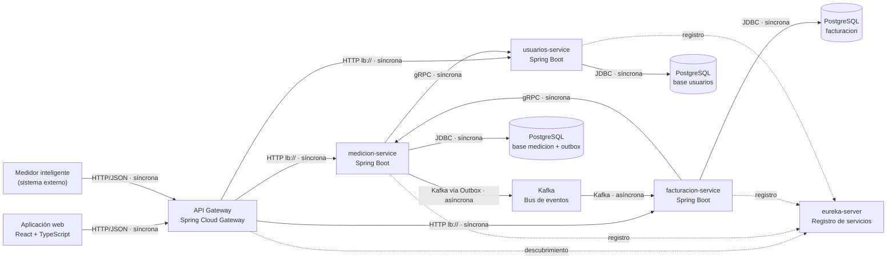

# Arquitectura de Smart Grid (Grupo 9)

## 1. Contexto y motivadores

Smart Grid monitorea el consumo eléctrico de medidores inteligentes, detecta anomalías de consumo, genera alertas y produce la facturación periódica. Lo usan el usuario/hogar (consulta su consumo y sus facturas) y el operador de red (registra medidores, resuelve anomalías, factura y ve el consumo por zona). El alcance está definido por el documento Requisitos_G9 (HU-01 a HU-09, R1 a R4, RNF1 a RNF3).

**Atributos de calidad prioritarios (ordenados).** El orden sale de los requisitos no funcionales del documento Requisitos_G9.

1. **Confiabilidad de la facturación** (RNF2, R2). *Escenario:* si entre las lecturas de un período hay un hueco mayor a la separación máxima configurada, `periodoCompleto` devuelve `false` y la factura no se genera (`PeriodoNoCerradoException`). Se verifica con un test unitario.
2. **Oportunidad de las alertas** (RNF3, HU-04). *Escenario:* una lectura que supera el umbral relativo al histórico del medidor guarda la anomalía y escribe el evento `anomalias.detectadas` en el outbox dentro de la misma transacción del `POST` de la lectura, no al facturar.
3. **Rendimiento sostenido de lecturas** (RNF1). *Escenario:* un `POST` de lectura no carga el historial completo del medidor, de modo que el número de consultas por `POST` no crece con el tamaño del historial.
4. **Seguridad (control de acceso).** *Escenario:* `DELETE /api/medidores/{medidorId}` solo lo acepta quien tiene rol OPERADOR; una factura solo la consulta un OPERADOR o el propietario del medidor.
5. **Testabilidad.** *Escenario:* las reglas de dominio se prueban sin base de datos ni red; cada servicio tiene su propia suite. Los `contextLoads` de facturacion y usuarios exigen Docker activo.

**Restricciones reales.**
- Equipo de backend de dos personas: Dev 1 (medicion y la unión de usuarios con los otros servicios) y Liceth (facturacion y usuarios).
- Pila definida: Java 25, Spring Boot 4.1.1, Spring Data JPA, PostgreSQL 16 en Docker Compose, Windows.
- El proyecto llega solo hasta la comunicación entre microservicios (decisión del 2026-11-10): no se construyen más arquitecturas.
- Las notificaciones de HU-05 no se evalúan; solo la generación y la emisión del evento.

## 2. Estilos y patrones por componente

| Componente | Estilo / patrón | Almacén de datos | Comunicación | Atributo que sirve |
|---|---|---|---|---|
| gateway | API Gateway; enruta por nombre de servicio (`lb://`) con descubrimiento de Eureka. Rutas: `/api/medidores/**` y `/api/anomalias/**` a medicion; `/api/facturas/**` y `/api/tarifas/**` a facturacion; `/api/auth/**` y `/api/usuarios/**` a usuarios | — | HTTP entrante; HTTP hacia los servicios | Seguridad (único punto de entrada) |
| usuarios-service | Microservicio + puertos y adaptadores; JWT HS256 | PostgreSQL, base `usuarios` | HTTP (sirve); gRPC `ExisteUsuarioActivo` en el puerto 9091 (sirve) | Seguridad; testabilidad |
| medicion-service | Microservicio + puertos y adaptadores; detección de anomalías en el `POST` de la lectura | PostgreSQL, base `medicion` | HTTP (sirve); gRPC (sirve consumo y anomalías a facturacion; llama a usuarios); eventos vía Outbox | Oportunidad de las alertas; rendimiento sostenido de lecturas |
| facturacion-service | Microservicio + puertos y adaptadores; facturación mensual programada | PostgreSQL, base `facturacion` (facturas, tarifas y copia local de medidores) | HTTP (sirve); gRPC (llama a medicion); consume eventos de medidores | Confiabilidad de la facturación; testabilidad |
| Outbox + Kafka | Transactional Outbox con sondeo (lotes de hasta 50, cada 2 s) y publicación en Kafka | Tabla outbox en la base de medicion | Publicar / suscribir | Oportunidad de las alertas; confiabilidad de la facturación |
| Eliminación de medidor | Flujo asíncrono por eventos: `DELETE` responde 202 y facturacion reacciona al evento de eliminación (no se presenta como saga completa) | — | Eventos | Seguridad (solo un OPERADOR la inicia) |

eureka-server no tiene fila propia porque no sirve por sí mismo a ninguno de los cinco atributos: es soporte del gateway. El problema que resuelve es que el gateway enruta por nombre de servicio en lugar de por dirección y puerto fijos.

**Prueba de necesidad.**
- Gateway: un solo punto de entrada para la aplicación web y el medidor.
- Outbox: evita guardar en la base y publicar en Kafka por separado (escritura dual).
- gRPC: consultas síncronas donde quien llama necesita la respuesta ya (¿el usuario existe y está activo?, ¿cuánto consumió el medidor en el período?).
- Puertos y adaptadores: probar el dominio sin infraestructura (fitness function 1).

**Antipatrones revisados.**
- Monolito distribuido por cadenas síncronas: no se observan cadenas de más de dos saltos entre servicios (facturacion→medicion; medicion→usuarios al registrar un medidor).
- Base de datos compartida: no; cada servicio apunta a su propia base (ADR-003, fitness function 2).
- Estilos sin problema concreto: CQRS y la saga no se construyeron y no figuran como implementados.

## 3. Diagrama de contenedores (C4)

Cada servicio se conecta a su propia base: medicion a `medicion` (puerto 5432), facturacion a `facturacion` (5433) y usuarios a `usuarios` (5435), según el `application.yaml` y el `docker-compose.yaml` de cada servicio. Kafka se declara en `infra/docker-compose.yaml`.

**Conexiones.** Consultar es síncrono (gRPC o HTTP); propagar un hecho es asíncrono (evento por outbox y Kafka).

**Eventos.**

| Evento | Productor | Consumidor | Datos |
|---|---|---|---|
| `anomalias.detectadas` | medicion (outbox) | Ninguno implementado: la entrega de la alerta no existe (ADR-005) | Los de la anomalía persistida: medidor, valor, instante y razón |
| `sensores.defectuosos` | medicion (outbox) | Ninguno implementado | Medidor, valor recibido (el valor negativo), instante y razón |
| Medidor registrado (`MedidorRegistradoListener`) | medicion | facturacion | Lo que facturacion necesita para mantener su copia local del medidor (`MedidorLocal`) |
| Medidor en eliminación (`MedidorEnEliminacionListener`) | medicion | facturacion | Lo que facturacion necesita para reaccionar sobre su copia local del medidor |

**Capa anticorrupción.** El único sistema externo es el medidor inteligente. Su lectura entra por `MedicionController.registrarLectura`, que descarta valores negativos (R1) y emite `sensores.defectuosos`. No se construyó una capa anticorrupción separada.

## 4. Decisiones (ADR)

- ADR-001: Descomponer el backend en tres microservicios (Aceptada)
- ADR-002: Comunicación: gRPC para consultas y Outbox con Kafka para hechos, detrás de un gateway (Aceptada)
- ADR-003: Una base de datos PostgreSQL por servicio (Aceptada)
- ADR-004: CQRS para las consultas de lectura (**Propuesta, no implementada**)
- ADR-005: Entrega de alertas por correo desde usuarios-service (**Propuesta, no implementada**)

### ADR-001: Descomponer el backend en tres microservicios

- Estado: Aceptada
- Fecha: 2026-10-27

**Contexto.** El backend empezó como un solo proyecto Spring Boot dividido en subdominios (Medición y anomalías, Facturación) con ramas por desarrollador. Usuarios nació directamente como proyecto independiente. La etapa del curso era la comunicación entre microservicios (Lección 6), y el equipo es de dos personas con dueños distintos por dominio.

**Decisión.** El backend queda en tres microservicios, uno por contexto delimitado: medicion-service (Dev 1), facturacion-service y usuarios-service (Liceth), con un gateway como entrada y un eureka-server. Cada servicio tiene su propia suite de tests.

**Consecuencias.**
- (+) Cada dominio se desarrolla, prueba y ejecuta por separado; las reglas de facturación no dependen del código de medición.
- (+) Cada servicio tiene su propio contrato (gRPC o HTTP) y su propio control de acceso.
- (−) Más piezas que operar: tres servicios, gateway, eureka-server, Kafka y las bases de datos, cada una con puerto propio.
- (−) Lo que antes era una llamada en proceso ahora es una llamada de red: si medicion-service no responde, no se puede generar una factura; si usuarios-service no responde, medicion responde 503.
- (−) Datos duplicados (copia local de medidores en facturacion) y consistencia eventual entre servicios.
- (−) Los `contextLoads` de facturacion y usuarios fallan sin Docker activo.
- (−) No se midió una ganancia de escalabilidad por servicio; la decisión se tomó por separación de dominios y por el objetivo del curso.

**Alternativa descartada.** Monolito modular (el estado inicial): se descartó porque el objetivo de esta etapa era practicar la comunicación entre servicios. Su ventaja, evitar fallas de red y duplicación de datos, se pierde.

### ADR-002: Comunicación: gRPC para consultas y Outbox con Kafka para hechos, detrás de un gateway

- Estado: Aceptada
- Fecha: 2026-10-27

**Contexto.** medicion necesita saber si un usuario existe y está activo al registrar un medidor. facturacion necesita el consumo y las anomalías no resueltas del período para facturar, y necesita conocer los medidores activos para la facturación mensual sin consultar a medicion cada vez. Una lectura negativa y una anomalía deben emitir un evento sin perderlo.

**Decisión.**
- Consultas síncronas por gRPC: `ExisteUsuarioActivo` (usuarios, puerto 9091) con plazo de 5 s, y la obtención de consumo y anomalías de medicion para facturacion.
- Hechos asíncronos con Transactional Outbox: el evento se guarda en la misma transacción que el cambio de negocio y un sondeo (lotes de hasta 50, cada 2 s) lo publica en Kafka.
- Entrada única por el gateway, que enruta por nombre de servicio (`lb://`) con Eureka.
- JWT validado en cada servicio con el secreto compartido emitido por usuarios.

**Consecuencias.**
- (+) No se pierden eventos aunque Kafka esté caído, porque el evento queda en la base junto con el cambio.
- (+) facturacion conoce los medidores por eventos y no depende de medicion para esa lista.
- (+) Si usuarios no responde dentro de 5 s, medicion captura el error y responde 503, sin colgarse.
- (−) Los consumidores pueden recibir duplicados y deben ser idempotentes.
- (−) El sondeo añade una espera de hasta el intervalo de 2 s antes de publicar y un proceso más que operar.
- (−) Las llamadas gRPC entre servicios se permiten sin autenticación (`GrpcSecurityConfig`), y el secreto JWT es compartido entre servicios.
- (−) facturacion-service incluye la dependencia de Resilience4j (Circuit Breaker); medicion-service, que llama a usuarios, no la tiene y solo usa el plazo de 5 s y la respuesta 503.
- (−) usuarios-service no tiene dependencia de Kafka, lo que limita lo que puede consumir hoy (ADR-005).

**Alternativas descartadas.**
- Guardar en la base y publicar en Kafka por separado (escritura dual): puede dejar el sistema inconsistente si el proceso cae entre ambas.
- Que facturacion consulte por gRPC la lista de medidores en cada corrida mensual: la haría depender de la disponibilidad de medicion para algo que puede propagarse después.

### ADR-003: Una base de datos PostgreSQL por servicio

- Estado: Aceptada
- Fecha: 2026-10-27

**Contexto.** El diagrama C4 inicial tenía una sola base de datos PostgreSQL para el backend. Con tres servicios, cada uno con su dueño, compartir esquema ata los cambios de un servicio a los de otro.

**Decisión.** Cada servicio es dueño de sus tablas y ningún servicio lee la base de otro; los datos ajenos llegan por gRPC o por eventos. medicion guarda medidores, lecturas, anomalías y el outbox; facturacion guarda facturas, tarifas (entidad propia, con vigencias sin superposición) y la copia local de medidores; usuarios guarda las cuentas.

**Consecuencias.**
- (+) Cada servicio puede cambiar su esquema sin coordinarse con los demás.
- (+) Verificado el 2026-11-12 en los `application.yaml` y los `docker-compose.yaml`: medicion usa la base `medicion` (puerto 5432), facturacion la base `facturacion` (5433) y usuarios la base `usuarios` (5435), cada una en su propio servicio de Compose.
- (−) Los servicios de base de datos de Compose no declaran volúmenes: los datos viven mientras exista el contenedor.
- (−) Datos duplicados (copia local de medidores) que pueden quedar desfasados hasta que llegue el evento.
- (−) El consumo acumulado no se guarda: se calcula sumando lecturas cada vez que se pide (`GET /api/medidores/{medidorId}/consumo`) y no existe una entidad `ConsumoAcumulado`.
- (−) Sin transacción entre servicios, la consistencia depende de eventos e idempotencia.

**Alternativa descartada.** Una base compartida por los tres servicios: permitiría uniones y transacciones únicas, pero acopla los esquemas, que es lo que la descomposición (ADR-001) busca evitar.

### ADR-004: CQRS para las consultas de lectura

- Estado: **Propuesta. No implementada.**
- Fecha: 2026-11-12

**Contexto.** El historial de consumo (HU-07) y el consumo por zona (HU-09) se leen hoy del mismo modelo transaccional de medicion donde se escriben las lecturas. El volumen sostenido de lecturas (RNF1) compite con esas consultas.

**Decisión propuesta.** Mantener la escritura de lecturas en medicion y crear un modelo de lectura separado, alimentado por eventos, para el historial y el consumo por zona. Hoy no existe un evento de lectura registrada que lo alimente.

**Consecuencias esperadas.**
- (+) Las consultas no compiten con la escritura sostenida de lecturas.
- (−) Consistencia eventual: el historial puede ir un poco por detrás de la última lectura.
- (−) Un componente más, un evento nuevo y más almacenamiento por operar.

**Alternativa considerada.** Mantener un solo modelo y limitar el costo con consultas acotadas y paginación dentro de medicion. No requiere componentes nuevos.

### ADR-005: Entrega de alertas por correo desde usuarios-service

- Estado: **Propuesta. No implementada.**
- Fecha: 2026-11-02 (decisión del equipo), registrada el 2026-11-12

**Contexto.** HU-05 pide que se alerte ante una anomalía. medicion genera y emite `anomalias.detectadas`, pero ningún servicio consume el evento ni entrega la alerta. El equipo decidió que la alerta llega al operador y que el correo (Gmail) puede salir desde usuarios-service.

**Decisión propuesta.** usuarios-service consume `anomalias.detectadas` y envía el correo al operador.

**Consecuencias esperadas.**
- (+) usuarios ya es dueño de los correos de las cuentas; medicion no necesita conocerlos.
- (−) usuarios-service necesita agregar la dependencia de Kafka, que hoy no tiene, y depende de un proveedor de correo externo.
- (−) Requiere un consumidor idempotente para no enviar correos duplicados.

**Alternativa considerada.** Que medicion envíe el correo directamente: mezclaría en medición una responsabilidad de comunicación con usuarios y necesitaría conocer sus correos.

## 5. Fitness functions

1. **El dominio no importa infraestructura.**
   - *Regla:* ninguna clase de un paquete `dominio` importa algo de `infraestructura`.
   - *Verificación:* desde la raíz del repositorio, en PowerShell:
     `Get-ChildItem -Recurse -Path "*\src\main\java" -Filter "*.java" | Where-Object { $_.FullName -match "\\dominio\\" } | Select-String -Pattern "import .*infraestructura"`
     No debe haber coincidencias.
   - *Cuándo:* manualmente antes de cada Pull Request. No está automatizada en CI; la evolución natural es una prueba ArchUnit (Propuesta, no implementada).
   - *Resultado (2026-11-12):* **cumple**, sin coincidencias.
2. **Ningún servicio usa la base de datos de otro.**
   - *Regla:* cada servicio apunta a una base distinta.
   - *Verificación:* `Select-String -Path "*\src\main\resources\application*.y*ml" -Pattern "jdbc:postgresql"` y comparar la base de cada servicio; deben ser distintas.
   - *Cuándo:* manualmente al cambiar la configuración de un servicio y antes de entregar.
   - *Resultado (2026-11-12):* **cumple**. medicion-service apunta a `localhost:5432/medicion`, facturacion-service a `localhost:5433/facturacion` y usuarios-service a `127.0.0.1:5435/usuarios`. Cada URL está en el `application.yaml` de su servicio y corresponde a un servicio de Compose distinto. No se consultaron las tablas dentro de los contenedores porque Docker no estaba disponible durante la revisión.

## 6. Mesh: ¿lo necesitamos?

- **Service mesh: no.** Hay 3 microservicios de negocio más gateway y eureka-server (5 procesos de backend) y un equipo de backend de 2 personas. No hay manifiestos de Kubernetes en el repositorio (la búsqueda de `kind: Deployment` en los `.yaml` no dio resultados); el entorno es local con Docker Compose. Los requisitos de seguridad y resiliencia los cubre cada servicio: JWT validado en cada uno, plazo de 5 s en la llamada a usuarios y Resilience4j declarado en facturacion-service. En lugar de un mesh usan el gateway, Eureka y gRPC con plazo.
- **Data mesh: no.** Hay un solo dominio de datos (consumo y facturación de una red) y un solo equipo de 2 personas; no hay varios equipos que publiquen datos como producto. En su lugar usan una base por servicio (ADR-003).

## 7. Riesgos y deuda conocida

- **Bases de datos sin volúmenes en Docker Compose.** `medicion-db`, `facturacion-db` y `usuarios-db` no declaran volúmenes, así que los datos se pierden si se elimina el contenedor. Si se materializa, se vuelven a crear los datos de prueba y se agregan volúmenes con nombre.
- **gRPC entre servicios sin autenticación** (`GrpcSecurityConfig`). Si se materializa un acceso no autorizado a los puertos gRPC, se restringen los puertos a la red interna y se agrega un interceptor que exija un token.
- **Secreto JWT compartido (HS256) entre servicios.** Si el secreto se filtra, se pueden emitir tokens válidos en todos los servicios; se rota el secreto y se reinician los tres.
- **Alertas sin entrega** (ADR-005). `anomalias.detectadas` y `sensores.defectuosos` se emiten pero nadie los consume; HU-05 queda cumplida solo en generación y emisión.
- **Sin Circuit Breaker en medicion-service.** Si usuarios queda lento, medicion solo se protege con el plazo de 5 s y la respuesta 503; se agrega Resilience4j, que ya está declarado en facturacion-service.
- **Consumo acumulado calculado bajo demanda y sin entidad propia.** Si el volumen de lecturas lo vuelve lento, se pasa a un consumo acumulado persistido o al modelo de lectura del ADR-004.
- **Idempotencia de consumidores no verificada.** Si los listeners de facturacion no son idempotentes, un duplicado del outbox puede repetir una acción; se agrega control por identificador de evento.
- **Pruebas que dependen de Docker.** Los `contextLoads` de facturacion y usuarios fallan sin Docker activo; se separan en un perfil de integración.
